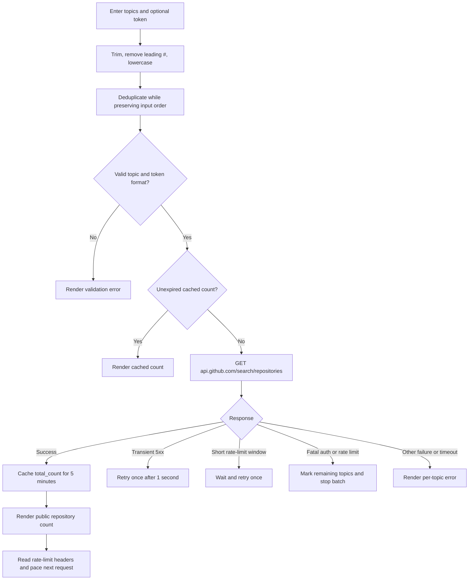

# GitHub Topic Popularity Checker

A lightweight, dependency-free browser tool that reports how many public GitHub repositories match each topic using GitHub's official REST API.

[](LICENSE)
[](https://github.com/assembly-automation-hub/GitHub-topic-popularity-Checker/stargazers)
[](https://github.com/assembly-automation-hub/GitHub-topic-popularity-Checker/issues)

> [!NOTE]
> This repository is a client-side web application, not a logging library or a packaged JavaScript module. There is no backend service, package manager configuration, build pipeline, or installable library API.

## Table of Contents

- [Features](#features)
- [Tech Stack & Architecture](#tech-stack--architecture)
  - [Project Structure](#project-structure)
  - [Key Design Decisions](#key-design-decisions)
- [Getting Started](#getting-started)
  - [Prerequisites](#prerequisites)
  - [Installation](#installation)
- [Testing](#testing)
- [Deployment](#deployment)
- [Usage](#usage)
- [Configuration](#configuration)
- [License](#license)
- [Contacts & Community Support](#contacts--community-support)

## Features

- **Bulk topic lookup:** Submit multiple topics in a single batch, one topic per line.
- **Input normalization:** Trims surrounding whitespace, removes leading `#` characters, and converts topic names to lowercase.
- **Stable deduplication:** Removes repeated normalized topics while preserving their first-seen order.
- **Client-side validation:** Accepts topic slugs of up to 50 lowercase alphanumeric or hyphen characters; a slug cannot begin or end with a hyphen. Invalid input is rejected before a request is made.
- **Public repository counts:** Queries GitHub's [`GET /search/repositories`](https://docs.github.com/en/rest/search/search#search-repositories) endpoint with `topic:<slug>` and displays the returned `total_count`.
- **Adaptive API pacing:** Reads rate-limit headers and adjusts spacing between sequential requests. It uses a small baseline delay when quota is healthy and spreads requests out as the remaining quota approaches exhaustion.
- **Short-lived in-memory cache:** Reuses a topic's result for five minutes in the current page session, avoiding repeat API calls. Cached values are cleared when the page is reloaded or closed.
- **Resilient requests:** Applies a 10-second timeout, retries transient `502`, `503`, and `504` responses once, and retries a rate-limited request once when the reported reset is within 15 seconds.
- **Fail-fast handling:** Stops the current batch after a fatal authentication or rate-limit failure instead of repeatedly making requests that cannot succeed.
- **Optional GitHub token:** An optional Personal Access Token raises the applicable Search API request limit. The token is only kept in the password field and request-handling memory; the application does not write it to browser storage or cookies.
- **Minimal attack surface:** No third-party runtime dependencies, analytics, backend, or build tooling. The page's Content Security Policy restricts connections to `api.github.com` and scripts/styles to same-origin files.
- **Responsive, accessible interface:** Uses native HTML controls, labels the inputs for assistive technology, exposes results through a polite live region, and includes visible keyboard-focus styling.

> [!IMPORTANT]
> GitHub's Search API quota is separate from the general REST API quota. The application sends one repository-search request per uncached, valid topic, sequentially. Large batches can take time, particularly without authentication or when nearing a rate limit.

## Tech Stack & Architecture

- **Languages:** HTML5, CSS, and vanilla JavaScript (ES6+).
- **Runtime:** Modern web browser with support for `fetch`, `AbortController`, `Map`, `Set`, and `DocumentFragment`.
- **External service:** GitHub REST API, specifically `GET /search/repositories`.
- **Dependencies:** None. There is no `package.json`, bundler, framework, server-side runtime, or external JavaScript package.

### Project Structure

```text
.
├── index.html   # UI markup, accessibility attributes, and Content Security Policy
├── style.css    # Responsive, GitHub-inspired interface styles
├── script.js    # Input normalization, validation, caching, API requests, and rendering
├── README.md    # Project documentation
└── LICENSE      # Apache License 2.0
```

### Key Design Decisions

1. **Direct browser-to-GitHub requests:** The app is static and calls GitHub from the user's browser. There is no server to deploy or maintain, and no request proxy that would need to handle credentials.
2. **Sequential requests:** Each topic is fetched in input order rather than concurrently. This simplifies quota-aware pacing and avoids bursts that are more likely to trigger secondary limits.
3. **Validate before querying:** Topic syntax is checked against the accepted slug format before building the API query. This prevents malformed input from being treated as a search expression and avoids unnecessary API consumption.
4. **Safe DOM rendering:** User-supplied topic text and result values are assigned using `textContent`, not interpolated into HTML. Results are prepared in a `DocumentFragment` to reduce repeated DOM updates.
5. **Ephemeral cache and token handling:** The cache is an in-memory `Map` with a five-minute TTL. Tokens are not persisted across reloads and are sent only to the GitHub API endpoint allowed by the page policy.

<details>
<summary>Request and result pipeline</summary>



The `total_count` is GitHub Search's count for the `topic:<slug>` query. It should be treated as an API search result, not as a permanent, real-time guarantee: repository visibility, indexing, and GitHub's search behavior can change.

</details>

## Getting Started

### Prerequisites

- A modern web browser with JavaScript enabled.
- Internet access to `https://api.github.com`.
- **Optional:** Python 3 (or another static HTTP server) if you prefer to serve the files locally rather than opening `index.html` directly.
- **Optional:** A GitHub Personal Access Token for a higher Search API request quota. No repository permissions or scopes are needed to search public repositories; use a token with no additional scopes/permissions where your token type supports that configuration.

No Node.js, Docker, database, or compilation toolchain is required.

### Installation

Clone the repository:

```bash
git clone https://github.com/assembly-automation-hub/GitHub-topic-popularity-Checker.git
cd GitHub-topic-popularity-Checker
```

Open `index.html` in a browser, or start a local static server:

```bash
python3 -m http.server 8000
```

Then visit <http://localhost:8000>.

> [!TIP]
> If your browser or security policy restricts API requests from a `file://` page, use the local HTTP server. For a LAN-accessible development server, Python can bind to all interfaces with `python3 -m http.server 8000 --bind 0.0.0.0`.

<details>
<summary>Troubleshooting and alternative local serving options</summary>

- **The page loads but API requests fail:** Confirm the browser has internet access, JavaScript is enabled, and a browser extension, firewall, or network policy is not blocking `api.github.com`.
- **A file-open launch is blocked:** Serve the directory over HTTP using Python, `npx serve .`, or an equivalent static server. `npx serve` requires Node.js and downloads/runs a package; it is not a project dependency.
- **HTTP 401 / invalid token:** Remove accidental whitespace and verify the token is current. The UI accepts an optional `Bearer ` or `token ` prefix and strips it before sending the token as a Bearer credential.
- **HTTP 403 / 429:** The Search API quota may be exhausted or a secondary rate limit may apply. Wait for the reset window, reduce the batch size, or provide an optional token. The app automatically retries only a short reported wait window.
- **No result appears for a line:** Empty lines are ignored. Topic text is normalized; values that do not match GitHub's topic slug format are displayed as invalid rather than queried.

</details>

## Testing

There is currently no committed automated unit or integration test suite, and no configured test runner or linter. The following checks are available without installing project dependencies:

```bash
# Check JavaScript syntax (requires Node.js, but does not run or bundle the app)
node --check script.js

# Serve the app for manual browser testing (requires Python 3)
python3 -m http.server 8000
```

For a manual end-to-end check, open <http://localhost:8000> and verify:

1. `api`, `react`, and `python` each produce a public repository count.
2. Inputs such as ` #React ` and `react` normalize to one `react` result.
3. Empty lines are ignored and malformed slugs (for example, `-invalid`) are rejected without an API call.
4. Rechecking a topic within five minutes uses the cached result; reload the page to clear the cache.
5. A missing or invalid token, timeout, API error, and rate-limit response are reported in the corresponding result row without breaking the page.

Browser developer tools can be used to inspect network requests and confirm requests target `api.github.com`. Do not use a real secret token in screenshots, recordings, or shared developer-tool logs.

> [!NOTE]
> There are no separate unit-test, integration-test, or lint commands such as `npm test`, `pytest`, or `flake8` because this project does not define those toolchains.

## Deployment

This application consists of static files and can be deployed to any static hosting provider that serves HTML, CSS, and JavaScript over HTTPS. No build step, container, environment-specific server process, or database migration is required.

1. Publish `index.html`, `style.css`, and `script.js` together, preserving their relative paths.
2. Enable HTTPS so the page can call GitHub's HTTPS API and users can safely enter an optional token.
3. Keep the Content Security Policy in `index.html` intact, or reproduce an equal-or-more-restrictive policy in the hosting configuration. The current policy permits connections only to `https://api.github.com`.
4. Smoke-test the deployed page by looking up a known public topic and confirming that the browser's network panel shows a request to `api.github.com`.

GitHub Pages and similar static hosting services are suitable. If using CI/CD, deployment can simply publish the repository's static root after checkout; there is no install or build command. Containerization is optional and unnecessary for the application itself.

> [!WARNING]
> Do not add a token to source files, a committed `.env` file, a deployment-time JavaScript constant, or a public build artifact. The intended flow is user-entered, ephemeral credentials. Anyone able to access a browser session can use a token entered into that session until it is cleared or the page is closed.

## Usage

1. Open the application in a browser.
2. Optionally enter a GitHub Personal Access Token in the password field to increase the Search API quota.
3. Enter one topic slug per line.
4. Select **Check Topics** and read each result beside its topic.

```text
api
react
python
```

The application trims each line, strips leading `#` characters, lowercases it, and removes duplicates without changing the order of the first occurrence. For example, ` #React ` and `react` are treated as the same topic. Each successful result is displayed as a localized number followed by `public`.

<details>
<summary>Advanced usage, API behavior, and edge cases</summary>

### Authentication and rate limits

The app queries GitHub's Search API. The existing application documents the following Search API limits:

| Mode | Search API limit documented by the project |
| --- | ---: |
| Unauthenticated | 10 requests per minute |
| Authenticated | 30 requests per minute |

GitHub can change quotas or apply secondary limits, so the response headers and current GitHub documentation take precedence over these reference values. A batch issues one request for every valid topic that is not already cached.

The optional token may be entered as the raw token, `Bearer <token>`, or `token <token>`. The app trims whitespace and sends the cleaned value as `Authorization: Bearer …`. No scopes are required for searching public repositories. Never paste a token into a shared or untrusted browser session.

### Error and retry behavior

- Each network request has a 10-second timeout.
- HTTP `502`, `503`, and `504` are retried once after a one-second delay.
- HTTP `403` or `429` is treated as a rate-limit condition. When `Retry-After` or `X-RateLimit-Reset` indicates a wait of 15 seconds or less, the app waits and retries once. Longer waits are reported and remaining requests are stopped.
- HTTP `401` is treated as a fatal invalid-token error and stops the batch.
- Other non-success responses are shown as per-topic errors. A `422` is reported as an invalid search query.
- Successful values are cached for five minutes in the current page context. Errors are not cached.

### Data and privacy boundaries

The page does not use `localStorage`, `sessionStorage`, or cookies for tokens or counts. A token is still visible to the browser runtime and is sent to GitHub as an authorization header; do not treat browser-side handling as equivalent to a server-side secret vault. The policy in the HTML restricts `connect-src` to GitHub's API, disallows external scripts and styles, and sets `Referrer-Policy` to `no-referrer`.

</details>

## Configuration

There is no `.env` file, configuration file, startup flag, or runtime settings screen. The application is configured by its source constants in `script.js` and security policy in `index.html`. The token is optional user input and is not a deployment configuration value.

<details>
<summary>Built-in settings and defaults</summary>

| Setting | Current default | Purpose |
| --- | --- | --- |
| GitHub API endpoint | `https://api.github.com/search/repositories` | Repository search endpoint used for each topic. |
| GitHub API version header | `2022-11-28` | Version sent in `X-GitHub-Api-Version`. |
| Accepted topic syntax | Lowercase letters, digits, and hyphens; 1–50 characters; no leading/trailing hyphen | Prevents invalid or unsafe topic search terms. Input is lowercased before validation. |
| Request timeout | `10,000 ms` | Aborts an individual fetch if it does not complete. |
| Cache TTL | `5 minutes` | Lifetime of successful topic counts in the in-memory cache. |
| Minimum delay with token | `250 ms` | Baseline spacing between requests when quota is sufficient. |
| Minimum delay without token | `500 ms` | Baseline spacing between requests when quota is sufficient. |
| Maximum paced delay | `10,000 ms` | Upper bound for calculated per-request pacing while quota remains. Exhausted quota waits until the reset time. |
| Short rate-limit retry window | `15 seconds` | Maximum reported wait for one automatic rate-limit retry. |
| Transient server retry | Once, after `1 second` | Applies to `502`, `503`, and `504`. |
| CSP connection source | `https://api.github.com` | Only allowed connection target in the page's Content Security Policy. |
| Token persistence | None | Token remains transient in the current page session and is not written to browser storage. |

</details>

## License

This project is licensed under the [Apache License 2.0](LICENSE). See the license text for the full terms, conditions, and permissions.

## Contacts & Community Support

## Support the Project

  [](https://devs-in-exile.pages.dev/)
  [](https://www.patreon.com/OstinFCT)
  [](https://ko-fi.com/fctostin)
  [](https://boosty.to/ostinfct)
  [](https://www.youtube.com/@FCT-Ostin)
  [](https://t.me/FCTostin)

If you find this tool useful, consider leaving a star on GitHub or supporting the author directly.
